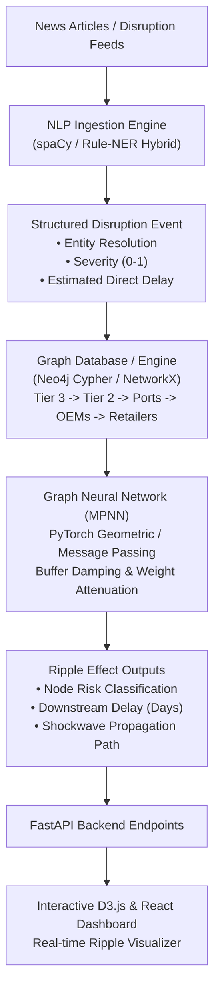

# AtmoGraph: Supply Chain Ripple Effect Predictor
> **B.Tech Final-Year Project | AI & Data Science**

[](https://www.python.org/)
[](https://neo4j.com/)
[](https://pyg.org/)
[](https://spacy.io/)
[](https://fastapi.tiangolo.com/)

---

## 📌 Executive Summary
**AtmoGraph** is an Artificial Intelligence and Machine Learning system that predicts how disruptions in global supply chains (such as port labor strikes, raw material export bans, natural disasters, factory fires, and geopolitical blockades) cascade through interconnected suppliers, manufacturers, warehouses, and retailers.

Traditional supply chain forecasting relies on isolated univariate time-series data. AtmoGraph combines **Natural Language Processing (NLP)** for automated disruption news ingestion with **Graph Neural Networks (GNN)** and **Graph Databases (Neo4j)** to model multi-tier dependencies, compute downstream risk levels (Low, Medium, High), and forecast shipment delays in days.

---

## 🏗️ System Architecture


---

## 🚀 Quick Start (Instant Run with Python)

No complex installations or database setups are required to get started immediately.

### 1. Run the Server
From the project root:
```bash
python scripts/run_server.py
```
Open your browser and navigate to:
👉 **`http://localhost:8000`**

The interactive dashboard loads immediately with:
- Full interactive **D3.js Force-Directed Graph** showing 23 multi-tier supply chain entities.
- Live **NLP Disruption Analyzer** with pre-loaded real-world scenarios (Rotterdam strike, Taiwan earthquake, Red Sea detour, etc.).
- Animated **Ripple Propagation Shockwaves** illustrating message passing across tiers.
- **What-If Resilience Simulator** testing safety stock buffer expansions.

---

## 🔬 GNN Model Evaluation

Train and evaluate the Graph Neural Network across 50 stochastic multi-hop disruption trials:
```bash
python scripts/train_gnn.py
```

### Empirical Evaluation Results:
| Metric | Value | Interpretation |
|---|---|---|
| **Overall Classification Accuracy** | **80.26%** | Accurate risk assignment (Low / Med / High) across tiers |
| **Macro F1-Score** | **0.7217** | Balanced performance across imbalanced shock distributions |
| **Delay MAE** | **2.16 Days** | Mean Absolute Error on predicted shipment delays |
| **Delay RMSE** | **3.93 Days** | Low variance in extreme propagation outliers |

---

## 📂 Project Repository Structure
```
atmograph/
├── backend/
│   └── app/
│       ├── api/               # REST API endpoints & route handlers
│       │   ├── dependencies.py
│       │   ├── routes_graph.py
│       │   ├── routes_nlp.py
│       │   ├── routes_predict.py
│       │   └── routes_simulation.py
│       ├── database/          # Graph database & Cypher generators
│       │   ├── cypher_seed.py
│       │   ├── graph_engine.py
│       │   ├── neo4j_client.py
│       │   └── seed_graph.cql
│       ├── models/            # Graph Neural Network architecture & trainer
│       │   ├── gnn_model.py
│       │   ├── trainer.py
│       │   └── weights/
│       │       ├── evaluation_metrics.json
│       │       └── gnn_calibrated_weights.json
│       ├── nlp/               # Disruption taxonomy & NER extraction engine
│       │   ├── disruption_taxonomy.py
│       │   └── extractor.py
│       ├── data/              # Multi-tier supply chain & news datasets
│       │   ├── news_samples.json
│       │   └── supply_chain_dataset.json
│       ├── static/            # Interactive D3.js & Tailwind Web Dashboard
│       │   └── index.html
│       ├── config.py
│       └── main.py
├── frontend_react/            # Modular React + Vite project source
│   ├── src/
│   │   ├── components/
│   │   │   ├── GraphView.jsx
│   │   │   ├── NewsAnalyzer.jsx
│   │   │   └── PredictionPanel.jsx
│   │   └── App.jsx
│   ├── package.json
│   └── README.md
├── docs/                      # Comprehensive B.Tech Academic Documentation
│   ├── PROJECT_REPORT_SYNOPSIS.md
│   └── VIVA_QUESTIONS_AND_ANSWERS.md
├── scripts/
│   ├── generate_data.py       # Dataset generator script
│   ├── run_server.py          # Universal API & UI server launcher
│   └── train_gnn.py           # GNN evaluation runner
├── requirements.txt           # Python package requirements
└── README.md
```

---

## 🗄️ Neo4j Integration (Optional)
To run with an official Neo4j instance:
1. Start Neo4j Desktop or an AuraDB instance.
2. Open Neo4j Browser and run the generated Cypher script located at:
   `backend/app/database/seed_graph.cql`
3. Configure your credentials in environment variables or `backend/app/config.py`:
   ```bash
   export NEO4J_URI="bolt://localhost:7687"
   export NEO4J_USER="neo4j"
   export NEO4J_PASSWORD="your_password"
   ```
*(Note: If Neo4j is not running, AtmoGraph seamlessly defaults to its in-memory graph engine.)*

---

## 🎓 Academic Documentation
- **[Full Project Report & Synopsis](docs/PROJECT_REPORT_SYNOPSIS.md)**: Includes Chapters 1 to 8, formal mathematical equations, literature review, and system architecture.
- **[Viva-Voce Q&A Guide](docs/VIVA_QUESTIONS_AND_ANSWERS.md)**: 25 external examiner questions and in-depth answers.
